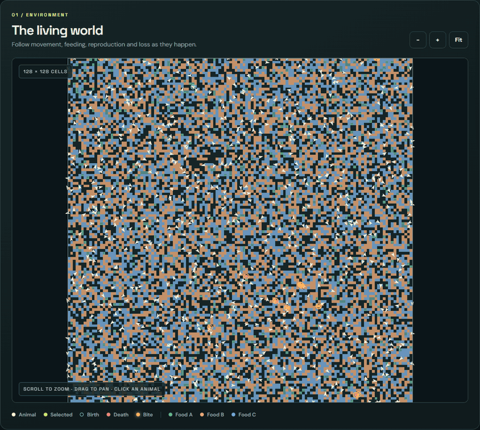
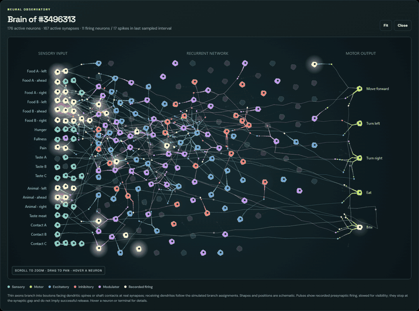

# Neural Selection

**Evolving spiking brains in a shared world.**

A CUDA C++ artificial-life simulation in which animals move, eat, bite one another, compete for resources, and reproduce. Each animal has its own mutable neural genome and a brain that processes sensory input through discrete spikes.

Survival is determined by the world. There is no fitness score or reward value supplied to the brain.



*An evolving population in the live world viewer. Food is shown in green, orange and blue; orange rings mark bites.*

## Look inside a brain

Select an animal to explore its actual network, including feedback loops, synaptic weights and firing activity. Axons branch into terminals meeting the receiving neuron's dendrites. Hover a neuron for its voltage and firing rate, or a terminal for its synapse's weight, delay and target branch.



*Timelapse captures from the running simulator. Shapes and positions are schematic; connections and spike counters come from the selected animal. Travelling pulses are slowed for visibility and do not imply successful synaptic release.*

## What evolves?

- **Brain design.** Neuron types, excitatory or inhibitory transmission, modulators, sensory assignments, connectivity, delays and synaptic parameters can mutate. Mutations can add, silence or remove neurons and connections.
- **Activity and plasticity.** Membrane dynamics produce spikes; synapses can facilitate, depress, and change strength through timing and modulatory mechanisms.
- **Ecological strategies.** Fixed senses report food identity, nearby animals, hunger, fullness, taste and pain. Five motor outputs control forward movement, turning, eating and biting.
- **Brain size.** Larger active brains cost more energy. All animals share global neuron and synapse pools, with no fixed brain-size allotment per animal.

Offspring inherit the genome's initial parameters and connections. They start with fresh neural state; a parent's learned synaptic weights and other lifetime neural state are not copied.

## Build and watch

Requires an NVIDIA GPU, a CUDA Toolkit with `nvcc`, CMake 3.24 or later, a compatible C++ compiler, and libpng and zlib development headers.

```sh
cmake -S . -B build -DCMAKE_CUDA_ARCHITECTURES=native
cmake --build build -j

mkdir -p runs
./build/neural_selection \
  --population 2048 --seed 2 --visualize \
  --output runs/world.csv
```

Open **[localhost:8765](http://127.0.0.1:8765/)**. The run continues indefinitely. Click an animal to inspect it, scroll to zoom, and drag to pan. The brain panel has an expanded view. The toolbar controls pause, speed and stopping.

| Speed | World steps per second |
| --- | --- |
| 1× | 20 |
| 4× | 80 |
| Max | As fast as the GPU allows |

Each world step advances 16 neural ticks of 1 ms. For a finite run, add `--steps 2000`. Use `--port N` to choose another local port. If configuring on a different machine, replace `native` with your target GPU's CUDA architecture.

### Keep a run alive when the terminal closes

With tmux installed:

```sh
tmux new-session -d -s neural-selection \
  './build/neural_selection --population 2048 --seed 2 --visualize --output runs/world.csv'
```

Attach with `tmux attach -t neural-selection`. Detach with **Ctrl+B, then D**. A tmux session survives closing the terminal or app; resumable checkpoints handle machine restarts.

### Save and resume

Live runs save an atomic, compressed checkpoint every **10,000 world steps**, at initialization, and on a normal stop. Checkpoints include the complete evolving world: genomes, learned synaptic state, neuron state, body state, resources, random generators and history counters.

```sh
./build/neural_selection \
  --resume runs/world.csv.checkpoint.gz --visualize
```

Resume restores the saved settings and continues from the last checkpoint. History beyond that checkpoint is rewound before recording continues. `--checkpoint-every N` changes the interval. **End run** writes final outputs and keeps the viewer open; **Ctrl+C** saves and exits. Checkpoints require a build with compatible state layout and simulation rules.

## The world

| Resource | Effect | Available senses |
| --- | --- | --- |
| Food A | Nutritious | Directional cues, contact identity and taste |
| Food B | Harmful | Directional cues, contact identity and taste |
| Food C | Inert | Contact identity and taste |
| Other animals | Can be bitten; lethal bites transfer some remaining energy | Directional presence, pain and meat taste |

Empty cells replenish food independently. Movement, biting, body upkeep and active neurons consume energy. Predators and prey are emergent roles; every animal has the same available senses and motor outputs.

Safety ceilings are **32,768 animals**, **4,194,304 neuron slots**, and **8,388,608 synapse slots**. Death returns brain slots to the global pools. `--population` sets the founding population, and the viewer shows current capacity use.

## Evidence, learning and limits

The neural ingredients are grounded in published recordings and small-circuit experiments: spike responses, sensory relays, dendritic summation, short-term synaptic dynamics, spike-timing plasticity and modulatory eligibility traces. The model combines several fitted cell and synapse phenotypes; it is not an anatomical reconstruction of a particular species.

**Reproducing local neural responses does not establish that the evolving animals learn useful behaviours.** Food-choice and lifetime measurements help investigate that question, but survival, repeated movement, or larger brains alone are not proof of learning or memory.

```sh
ctest --test-dir build --output-on-failure
python3 tests/checkpoint_roundtrip.py ./build/neural_selection
python3 tools/analyze_behavior.py runs/world.csv
```

See [the experimental reproductions](EXPERIMENTS.md) for protocols, results and remaining gaps, and [the neural model](docs/NEURAL_MODEL.md) for mechanisms and original publications.

## Outputs and further reading

| File | Contents |
| --- | --- |
| `<output>` | Population, births, deaths, predation, resources and brain-slot history |
| `<output>.behavior.csv` | Food-choice and movement measurements |
| `<output>.lives.csv` | Sampled completed lifetimes |
| `<output>.checkpoint.gz` | Resumable world state |
| `<output>.png` | Final world image |
| `<output>.neurons.csv`, `<output>.synapses.csv` | Final neural genomes and synaptic state |

[Running, profiling and interpreting behaviour](docs/RUNNING.md) · [Neural model and sources](docs/NEURAL_MODEL.md) · [Experimental reproductions](EXPERIMENTS.md)

## License

[MIT](LICENSE). Third-party notices are preserved in [LICENSES](LICENSES/).
