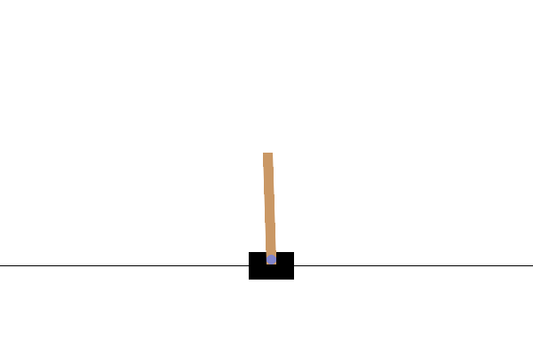

# First CartPole evolution experiment

**Invalid selection protocol:** these historical searches fed validation-selected champions back into breeding. They have been cancelled; these results are not clean evidence of generalization or memory. Corrected searches start from random populations under `fresh-training-only-v2`.



128 independently initialized genomes evolved for **209 evaluated generations** in `CartPole-v1`, using episode return as selection fitness. Evolution took approximately **254 seconds** with eight CPU workers on the test machine.

| Policy | Mean return on 100 fresh test episodes |
| --- | ---: |
| Random actions | 22.68 / 500 |
| Best first-generation candidate by training return | 104.41 / 500 |
| Best validated evolved genome | **426.01 / 500** |

The champion lasted all 500 steps in **55 of 100** held-out episodes. Its validation mean was 477.83 on 12 separate validation seeds, which triggered the run's 475 validation stopping target. The lower held-out mean means this run did not meet a 475/500 threshold on its final test set.

The final genome has **10 neurons** (eight opponent sensory ports and two motor ports), **eight synapse genes (seven enabled)**, and no hidden cells. Topology mutation was enabled; a small graph was sufficient for this task. The candidate population began with 24 randomly initialized synapses per genome. There is no hand-written balancing controller, backpropagation, reward input to the neural network, or applied constant current in hidden or motor cells.

Sensory encoding, motor decoding, and observation scales are fixed adapter choices. A zero-valued observation drives its two opponent sensory channels equally. The run used observation scales `2.4,1,0.05,0.25`, 16 neural ticks per action, and motor filtering with coefficient 0.4. Those observation scales were selected after an earlier, smaller experiment performed near the random baseline; these results are a single exploratory run, not a controlled comparison of algorithms.

The GIF shows seed `1001000`, one of the earlier evaluation episodes, with a return of 500. It illustrates the policy's behaviour; the table reports performance across all 100 test seeds. The final reported test used seeds `2001000` through `2001099`, after freezing the champion, to avoid overlap with pilot evaluations. Earlier evaluation returns are retained in `results.json`. The saved champion and measurements remain replayable even if later changes alter the evolutionary search.

## Files

- [champion.json](champion.json): evolved genes, containing no lifetime neural state.
- [initial.json](initial.json): best initial candidate used for comparison.
- [results.json](results.json): individual episode returns, settings and test seeds.
- [history.csv](history.csv): training and validation history.

## Replay

From the repository root:

```sh
.venv-gym/bin/python -m gym_adapter.replay \
  examples/gym-cartpole/champion.json \
  --results examples/gym-cartpole/results.json --seed 1001000
```

[Adapter setup and training instructions](../../docs/GYMNASIUM.md)
