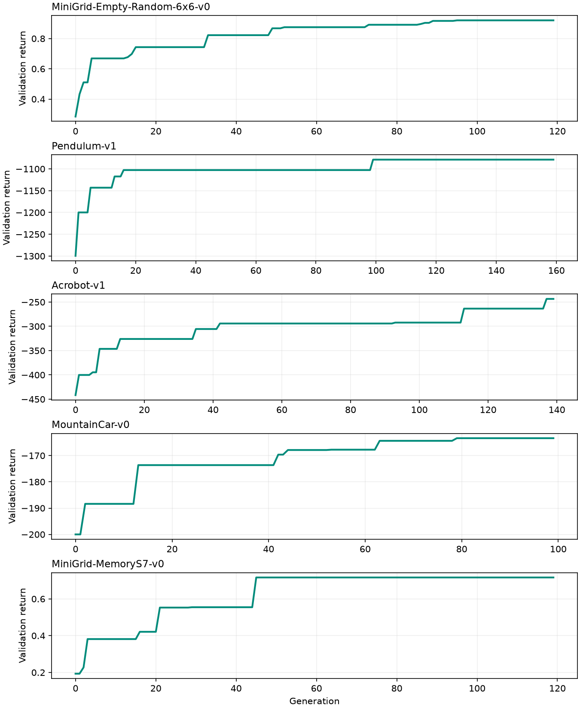
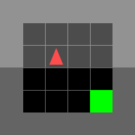
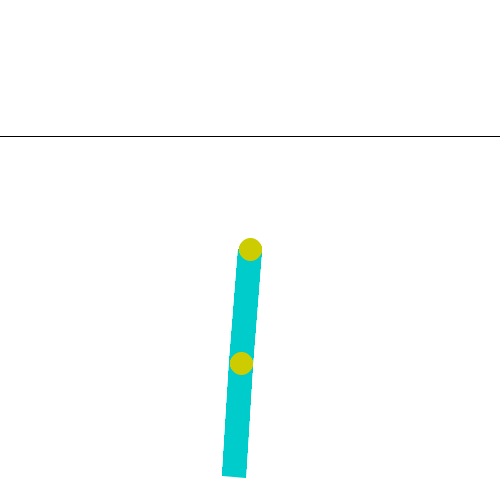
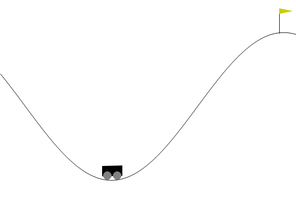
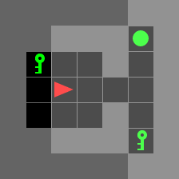

# Exploratory Gymnasium environment suite

**Invalid selection protocol:** these historical searches fed validation-selected champions back into breeding. They have been cancelled; these results are not clean evidence of generalization or memory. Corrected searches start from random populations under `fresh-training-only-v2`.

Independent evolutionary searches using the same physiological brain model. Rewards select genomes externally and never enter the brain. Hidden/motor applied current remains zero. Each champion starts every episode from its genome, with no lifetime state inherited.

The table contains **untouched final test seeds**, evaluated on CPU. Each environment received one search run with the recorded budget; this is an exploratory comparison, not an exhaustive tuning study.

| Environment | Random return | Best initial return | Evolved return | Goal success | Generations | Brain neurons / synapses |
| --- | ---: | ---: | ---: | ---: | ---: | ---: |
| MiniGrid-Empty-Random-6x6-v0 | 0.287 | 0.427 | **0.908** | 100% (100 episodes) | 120 | 312 / 89 |
| Pendulum-v1 | -1240.028 | -1307.698 | **-1268.285** | — | 160 | 13 / 16 |
| Acrobot-v1 | -499.980 | -419.540 | **-317.740** | 82% (50 episodes) | 140 | 28 / 42 |
| MountainCar-v0 | -200.000 | -200.000 | **-184.660** | 28% (50 episodes) | 100 | 12 / 27 |
| MiniGrid-MemoryS7-v0 | 0.188 | 0.160 | **0.233** | 28% (100 episodes) | 120 | 321 / 143 |

Brain sizes are genome counts, including disabled elements. The complete results retain all per-episode returns.

## Observations

MiniGrid-Empty-Random-6x6-v0 sensory check, on 100 separate post-training seeds: normal observations 100% success, constant opponent input 46%, first view frozen 54%. These interventions test sensory dependence and do not establish learning within a lifetime.

Pendulum-v1 did not beat random actions on held-out seeds. A better validation score did not transfer to the final test set.

Acrobot-v1 reached its goal in 41/50 held-out episodes.

MountainCar-v0 reached its goal in 14/50 held-out episodes.

MiniGrid-MemoryS7-v0 sensory check, on 100 separate post-training seeds: normal observations 36% success, constant opponent input 28%, first view frozen 26%. These interventions test sensory dependence and do not establish learning within a lifetime.

## Training curves

These are the best validation returns retained over generations. They are selection curves, separate from final held-out returns.

## Replays

Each GIF shows the **upper-median held-out episode by return**, chosen after final testing. It is not a selected best case. The original Gymnasium rendering displays the world; brains receive only the observations documented in the adapter guide.

### MiniGrid-Empty-Random-6x6-v0

Replay seed: `4021095`. [Genome](minigrid-empty-random/champion.json), [complete test results](minigrid-empty-random/results.json), [training history](minigrid-empty-random/history.csv), [exact command](minigrid-empty-random/command.json).

### Pendulum-v1

Replay seed: `4022007`. [Genome](pendulum/champion.json), [complete test results](pendulum/results.json), [training history](pendulum/history.csv), [exact command](pendulum/command.json).

### Acrobot-v1

Replay seed: `4023029`. [Genome](acrobot/champion.json), [complete test results](acrobot/results.json), [training history](acrobot/history.csv), [exact command](acrobot/command.json).

### MountainCar-v0

Replay seed: `4024032`. [Genome](mountaincar/champion.json), [complete test results](mountaincar/results.json), [training history](mountaincar/history.csv), [exact command](mountaincar/command.json).

### MiniGrid-MemoryS7-v0

Replay seed: `4025073`. [Genome](minigrid-memory/champion.json), [complete test results](minigrid-memory/results.json), [training history](minigrid-memory/history.csv), [exact command](minigrid-memory/command.json).

## Interpretation and limits

Navigation success does not by itself demonstrate memory or learning within a lifetime. MiniGrid Memory needs a separate cue-dependence/state-ablation analysis before attributing success to memory. A fixed sequence or simple reactive policy can perform well in some benchmarks. These are reduced neuron models; optimized parameters and firing rates may lie outside their experimentally fitted regimes.

MiniGrid uses the full standard 7×7 partial symbolic view with object/color/state fields. The fixed text mission and compass are removed. There is no privileged global position, full map, goal direction, reward shaping or action mask. The seven native actions remain available. The Memory search/evaluation cap is 196 steps (its native limit is 245); Empty-Random uses its native 144-step limit.

CUDA performs population evaluation for MiniGrid; classic-control searches use eight CPU workers. Validation and all final testing run on CPU. Test seeds were fixed in the suite plan before training. No test return selected genomes or settings. Each experiment retains resumable checkpoints locally under `runs/gym-suite/`; these large population-state files are not copied into the examples.

[Adapter guide](../../docs/GYMNASIUM.md) · [Performance measurements](../../docs/GYM_PERFORMANCE.md)
